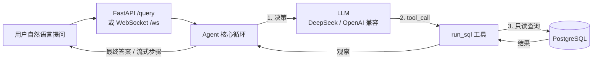

# SQL 数据分析 Agent

一个从零手写的 ReAct 风格数据分析 Agent：用户用自然语言提问，Agent 自动生成 SQL 查库、基于真实结果作答。

工程上强调 **安全、可靠、可观测、可评测**，封装成 FastAPI + WebSocket 服务，支持 MCP 协议，Docker 一键起。核心循环**手写实现**（不依赖 LangChain 等框架），把「LLM 决策 / 代码执行」的边界、安全防御、可靠性、可观测性、评测全部自己实现了一遍。

> 当前版本 **v1.0** —— 核心链路完整、可跑、可评测，后续持续优化（见文末 Roadmap）。

## ✨ 亮点

| 能力 | 说明 |
|---|---|
| 🧠 手写 Agent 循环 | ReAct 风格：LLM 只做决策，代码负责执行（安全边界） |
| 🛡️ 四层防御纵深 | 只读事务 + `statement_timeout` + 行数上限 + 关键字黑名单 |
| 🔁 可靠性 | 指数退避重试、重复调用检测、最大步数限制 |
| 📊 结构化可观测 | 每步 trace 记录耗时 + token，可导出 JSON |
| ✅ 自动化评测 | execution accuracy + 「关键值包含」判定，避免假阴性 |
| ⚡ 全链路 async + WebSocket | 流式推送每一步，支持客户端中途取消 |
| 🔌 MCP 支持 | 同一能力暴露成标准 MCP server，任何客户端可连 |
| 🐳 Docker 一键起 | `docker compose up` 即可复现 |

## 🏗️ 架构



核心思想一句话：**LLM 只负责决策（生成 SQL 和工具调用），代码负责执行（查库、校验、限流）**。模型输出永远不可信，执行层才是安全边界。

## 🚀 快速开始

### Docker（推荐）

```bash
# 1. 设好 API key（可选，不设则用 Mock 离线跑）
export DEEPSEEK_API_KEY=sk-xxx    # Windows cmd 用 set

# 2. 一键起（Postgres + FastAPI）
docker compose up --build

# 3. 测试普通请求
curl -X POST http://127.0.0.1:8000/query \
  -H "Content-Type: application/json" \
  -d '{"question":"用户总数是多少"}'

# 4. WebSocket 流式（逐条收每一步）
python test_ws.py
```

### 本机跑（不用 Docker）

```bash
# 1. 起 Postgres（或复用已有的，DATABASE_URL 默认 localhost:5433）
docker compose up db

# 2. 装依赖
pip install -r requirements.txt

# 3. CLI 跑
set DEEPSEEK_API_KEY=sk-xxx
python main.py

# 4. 或起 API
uvicorn api:app --reload
```

## 📁 项目结构

```
sql_agent/
├── agent/
│   ├── llm.py      # LLM 接口：AsyncOpenAI 实现 + MockLLM（离线测试）
│   ├── tools.py    # Tool + ToolRegistry（工具定义与调度）
│   ├── core.py     # Agent 核心循环（async）
│   └── trace.py    # 结构化 trace（可观测性）
├── db.py           # 数据库访问层（只读 + 超时 + 行数上限）
├── api.py          # FastAPI /query + WebSocket /ws（流式 + 取消）
├── main.py         # CLI 入口
├── eval.py         # 评测
├── mcp_server.py   # MCP server（能力暴露成标准协议）
├── mcp_client.py   # MCP client（演示调用）
├── seed.sql        # 建表 + 测试数据
├── test_safety.py  # 安全测试
├── test_ws.py      # WebSocket 客户端测试
└── docker-compose.yml
```

## 🎯 核心设计

### 1. Agent 循环：LLM 决策 / 代码执行 分离

模型只输出「要调哪个工具、什么参数」，SQL 执行、参数校验、循环控制全在代码里。

与 Web 后端防注入的区别：agent 的 SQL 是**模型生成的**，没法用参数化查询防注入，所以靠「只读 + 限流 + 校验」的纵深防御。

### 2. 四层安全防御（db.py）

1. 只读事务 `default_transaction_read_only=on`
2. `statement_timeout=5000`（防 `pg_sleep` 拖死连接）
3. `fetchmany(1001)`（行数上限，防百万行打爆内存）
4. 关键字黑名单（Pydantic 校验，拒 DELETE / UPDATE / INSERT 等）

任何一层失效，还有下一层兜底。

### 3. 可靠性

- **重试退避**：只对临时性错误（429 / 5xx / 超时）重试，1s→2s→4s 指数退避；401 / 400 不重试
- **重复调用检测**：模型原地打转（连续发相同工具调用）时喊停
- **最大步数限制**：防死循环

### 4. 可观测性（trace）

每一步（LLM 决策 / 工具执行）都记成结构化事件：`step`、`tool`、`arguments`、`result`、`latency_ms`、`usage`（token）。回答三个问题：**错在哪步、慢在哪步、贵在哪**。

### 5. 评测（eval.py）

用 **execution accuracy**（执行结果比对）。关键设计：不用「结果集完全相等」，而用**「期望关键值是否出现在结果里」**——因为 agent 常返回「对但多列」的答案，严格相等会假阴性；并收集**所有步骤**的结果并集（多步 agent 每步都不完整）。

### 6. 全链路 async + WebSocket

`agent.run()` 是 async 协程；工具并行用 `asyncio.gather` + `asyncio.to_thread`。WebSocket 支持**流式推步骤 + 客户端取消**（`task.cancel()` + `CancelledError`）。

## 🔌 MCP

同一套能力（`run_sql`）用 `@mcp.tool()` 暴露成标准 MCP server，任何 MCP 客户端都能连：

```bash
python mcp_client.py
```

## 🛠️ 技术栈

Python · FastAPI · WebSocket · PostgreSQL · psycopg · OpenAI 兼容 API（DeepSeek）· MCP · Docker

## 🗺️ 版本与后续优化（Roadmap）

当前 **v1.0**。后续可能优化的方向：

- **记忆 / 多轮对话**：记住上文查过的 schema 和结果，减少重复查库
- **工具扩展**：从单个 `run_sql` 扩展到更多工具（写报告、画图等）
- **更强安全**：SQL AST 解析级校验（只允许 SELECT + 白名单列），替代关键字黑名单
- **结构化输出**：用 JSON schema 约束 agent 输出，减少解析失败
- **评测平台化**：更多 case + CI 自动回归
- **多 agent / 编排**：拆「规划 + 执行」agent，或引入 LangGraph 做状态机
- **流式 LLM 输出**：SSE 流式收 token，进一步降低首字延迟
- **生产化**：鉴权、限流、日志采集、监控告警

## 📝 License

MIT
