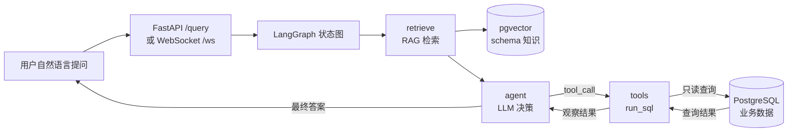

# SQL 数据分析 Agent

用自然语言问数据，Agent 自动生成 SQL 查库、基于真实结果作答。基于 **LangChain + LangGraph** 编排，叠加 **RAG（pgvector）** 检索 schema 知识，工程上强调安全、可靠、可观测、可评测。

> 当前版本 **v2.0** —— 由 v1 的「手写 ReAct 循环」重写为 **LangGraph 状态机 + RAG 检索**，安全防御、评测、WebSocket、MCP、Docker 全部保留。

## ✨ 亮点

| 能力 | 说明 |
|---|---|
| 🕸️ LangGraph 状态机 | `retrieve → agent ⇄ tools` 三节点 + 条件边路由，替代手写 while 循环 |
| 📚 RAG 检索 | bge-small-zh 本地向量化 + pgvector，把 schema 业务语义注入 prompt |
| 🛡️ 四层防御纵深 | 只读事务 + `statement_timeout` + 行数上限 + 关键字黑名单 |
| 🔁 可靠性 | SDK 重试 + 请求超时 + 连接超时，失败快速报错不再挂起 |
| ✅ 自动化评测 | execution accuracy + 「关键值包含」，5 个 case 回归 |
| ⚡ async + WebSocket | 流式推每一步（retrieve/agent/tools），支持客户端取消 |
| 🔌 MCP 支持 | 同一能力暴露成标准 MCP server |
| 🐳 Docker 一键起 | `docker compose up` 即可复现 |

## 🏗️ 架构



核心思想一句话：**LLM 只负责决策（生成 SQL 和工具调用），代码负责执行（查库、校验、限流）**。RAG 让模型在决策前先看到「相关表结构 + 业务语义」，减少查错列、凭空猜字段。

## 🚀 快速开始

### Docker（推荐）

```bash
# 1. 设好 API key
export DEEPSEEK_API_KEY=sk-xxx    # Windows cmd 用 set

# 2. 一键起（Postgres + pgvector + FastAPI）
docker compose up --build

# 3. 建 RAG 索引（宿主机跑，连容器里的 db：默认 localhost:5433）
python -m rag.ingest

# 4. 测试普通请求
curl -X POST http://127.0.0.1:8000/query \
  -H "Content-Type: application/json" \
  -d '{"question":"用户总数是多少"}'
```

### 本机跑（不用 Docker）

```bash
# 1. 起 Postgres（pgvector 镜像，映射到宿主机 5433）
docker compose up -d db

# 2. 装依赖
pip install -r requirements.txt

# 3. 设 key + 建索引
set DEEPSEEK_API_KEY=sk-xxx
python -m rag.ingest

# 4. CLI 跑，或起 API
python main.py
uvicorn api:app --reload
```

> **embedding 模型**：首次跑 `rag.ingest` 需要 `bge-small-zh-v1.5`（约 100MB）。国内建议先用镜像下载：`set HF_ENDPOINT=https://hf-mirror.com`，再跑一次让它缓存到本地。代码里默认 `local_files_only=True`（离线加载，避免连 huggingface.co 卡死），所以**模型必须先缓存好**。
>
> **Docker 里跑 RAG**：api 容器做检索时同样要加载 embedding 模型，需把宿主机 `~/.cache/huggingface` 挂进容器；否则建议「db 放容器、API 本机跑」，这样共用宿主机已有的模型缓存。

## 📁 项目结构

```
sql_agent/
├── graph/              # LangGraph 状态图（v2 核心）
│   ├── state.py        # AgentState：TypedDict + add_messages reducer
│   ├── nodes.py        # retrieve / agent 节点 + 条件路由 should_continue
│   └── graph.py        # build_graph()：三节点 + 条件边组装
├── rag/                # RAG：schema 向量化与检索
│   ├── embed.py        # bge-small-zh 本地 embedding（离线加载）
│   ├── schema_docs.py  # 业务语义 + 动态结构的文档块
│   ├── ingest.py       # 建索引：文档 → 向量 → pgvector
│   └── retrieve.py     # 相似度检索 top-k
├── llm.py              # ChatOpenAI 封装（DeepSeek OpenAI 兼容）
├── tools.py            # @tool 包装 run_sql + 关键字黑名单
├── db.py               # 数据库访问层（只读 + 超时 + 行数上限）
├── api.py              # FastAPI /query + WebSocket /ws（流式 + 取消）
├── main.py             # CLI 入口
├── eval.py             # 评测（5 case）
├── mcp_server.py       # MCP server（能力暴露成标准协议）
├── mcp_client.py       # MCP client（演示调用）
├── seed.sql            # 建表 + 测试数据（含 vector 扩展）
├── test_api.py         # API 测试
├── test_safety.py      # 安全测试
├── test_ws.py          # WebSocket 客户端测试
├── docker-compose.yml  # Postgres(pgvector) + FastAPI
└── Dockerfile
```

## 🎯 核心设计

### 1. LangGraph 状态机（graph/）

v1 手写的 `while` 循环，v2 用「状态图 + 条件边」表达同一个 ReAct 循环：

```
START → retrieve → agent ⇄ tools → END
```

- `AgentState.messages` 用 `add_messages` reducer：节点返回新消息时是**追加**而非覆盖，`agent ⇄ tools` 循环里历史消息自动累积（替代 v1 手写维护 messages 列表）。
- `should_continue()` 看最后一条消息是否还带 `tool_calls`：有 → 去 tools；没有 → END。

### 2. RAG 检索（rag/）

- **索引源**：`schema_docs.py` 把「业务语义」+「动态表结构」写成文档块。纯 `information_schema` 只有列名类型、没有业务含义（amount 是金额还是数量、统计总额要 JOIN 哪张表），所以额外补语义。
- **向量化**：`bge-small-zh-v1.5`（中文小模型，约 100MB，本地跑不调 API）。
- **存储**：pgvector（`PGVector`，collection `schema_docs`），连接串用 `postgresql+psycopg://` 指定 psycopg3 驱动。
- **检索**：`retrieve_context(question, k=3)` 取 top-k 相关文档，注入 agent 的 system prompt。

### 3. LLM 与工具（llm.py / tools.py）

- `ChatOpenAI(base_url=DeepSeek)` 复用 OpenAI 兼容接口；`temperature=0`（决策要稳定）+ `max_retries=3` + `timeout=60`，并校验 key 未设置时直接报错。
- `@tool("run_sql", args_schema=RunSQLArgs)`：入参先过 Pydantic 校验（关键字黑名单）才执行；`bind_tools` 把工具转成 function calling 格式。模型只看到 name/description/schema，永远看不到函数体。

### 4. 四层安全防御（db.py + tools.py）

1. 只读事务 `default_transaction_read_only=on`
2. `statement_timeout=5000`（防 `pg_sleep` 拖死连接）
3. `fetchmany(1001)`（行数上限，防百万行打爆内存）
4. 关键字黑名单（Pydantic 校验，拒 DELETE / UPDATE / INSERT 等）

外加 `connect_timeout=5`：数据库没起时 5 秒报错，而不是无限挂起。

与 Web 后端防注入的区别：agent 的 SQL 是**模型生成的**，没法用参数化查询防注入，所以靠「只读 + 限制 + 校验」的纵深防御，而不是参数化。

### 5. 评测（eval.py）

用 **execution accuracy**（执行结果比对）。关键设计：不用「结果集完全相等」，而用**「期望关键值是否出现在结果里」**——因为 agent 常返回「对但多列」的答案，严格相等会假阴性；并收集**所有步骤**的结果并集。5 个 case 覆盖 count / max / group-by-sum / 单用户多条件。

### 6. async + WebSocket（api.py）

`graph.astream(stream_mode="updates")` 流式产出每一步；三任务架构：`run_agent`（生产，往队列塞）→ `forward`（消费，推前端）→ `watch`（监听取消）。

## 🔌 MCP

同一套能力（`run_sql`）用 `@mcp.tool()` 暴露成标准 MCP server，任何 MCP 客户端都能连：

```bash
python mcp_server.py
python mcp_client.py
```

## 🛠️ 技术栈

Python · LangChain（langchain-core / langchain-openai）· LangGraph · pgvector（langchain-postgres）· sentence-transformers（bge-small-zh）· FastAPI · WebSocket · PostgreSQL · psycopg · DeepSeek（OpenAI 兼容）· MCP · Docker

## 🗺️ 版本与 Roadmap

- **v1.0**：手写 ReAct 循环 + 四层防御 + trace 可观测 + 评测 + WebSocket + MCP + Docker
- **v2.0（当前）**：LangChain / LangGraph 重写 + RAG（pgvector）检索 schema 知识

后续方向：

- **记忆 / 多轮对话**：记住上文查过的 schema 和结果，减少重复查库
- **工具扩展**：从单个 `run_sql` 扩展到更多工具（写报告、画图等）
- **更强安全**：SQL AST 解析级校验（只允许 SELECT + 白名单列），替代关键字黑名单
- **结构化输出**：用 JSON schema 约束 agent 输出，减少解析失败
- **评测平台化**：更多 case + CI 自动回归
- **多 agent / 编排**：拆「规划 + 执行」agent
- **流式 LLM 输出**：SSE 流式收 token，进一步降低首字延迟
- **生产化**：鉴权、限流、日志采集、监控告警

## 📝 License

MIT
